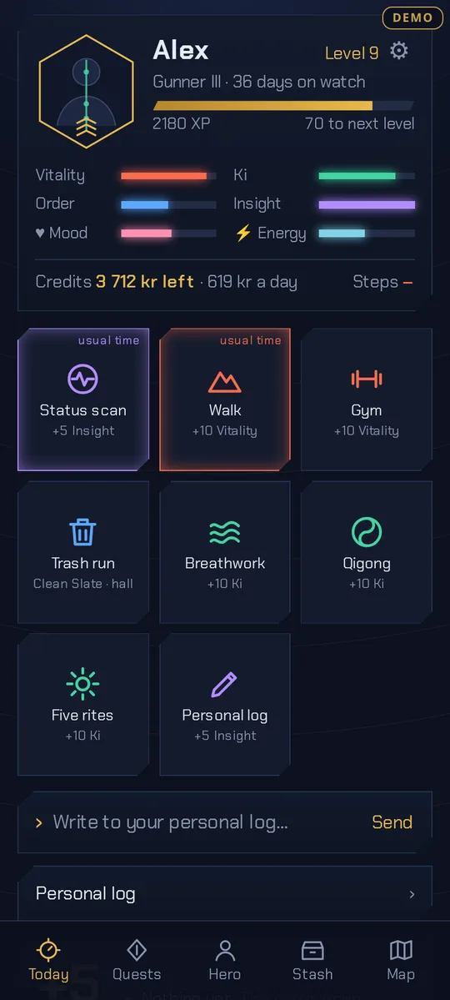
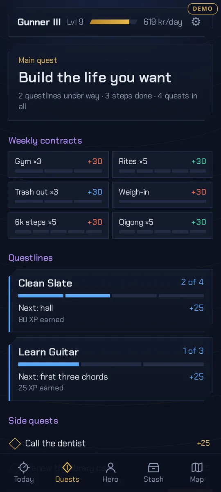
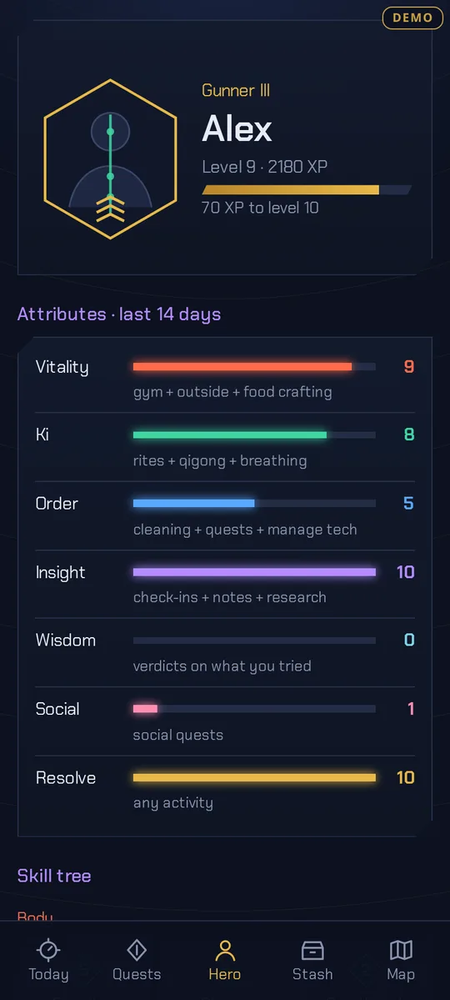
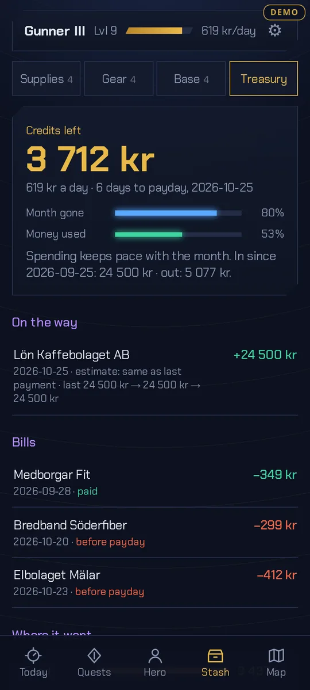
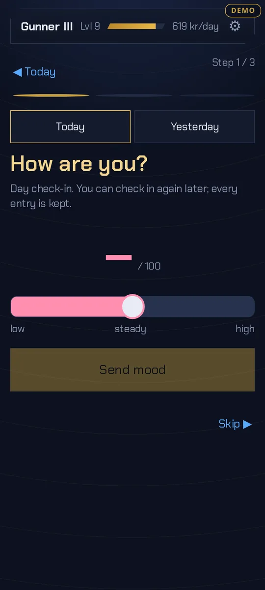
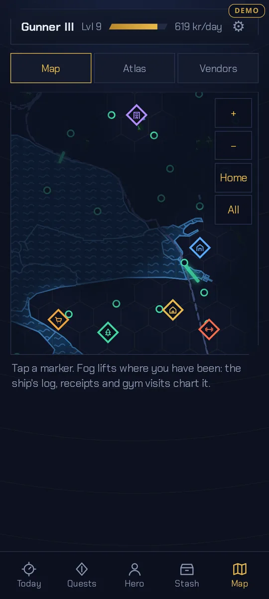
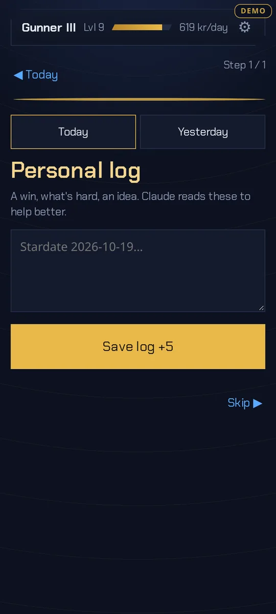
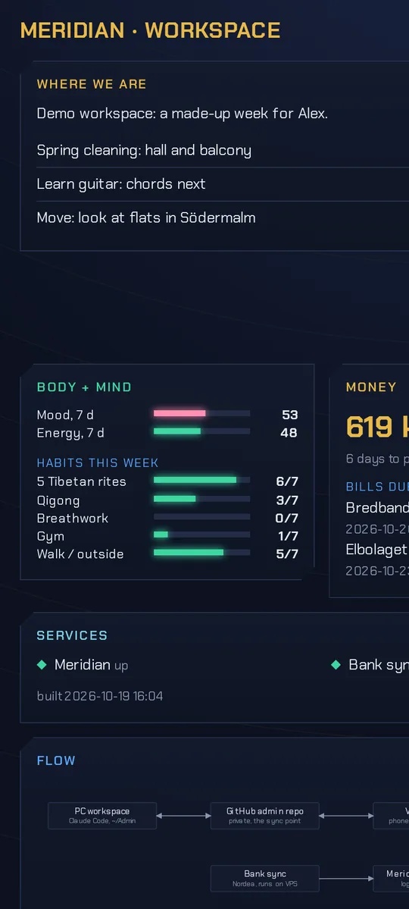

# Meridian

A personal phone app that turns daily routines into a light role-playing game: habits, mood and energy, cleaning, quests, a shopping list and inventory, plus a budget view fed by a live bank sync. Notes written in the app are read and answered by an AI assistant running on the same server. One person, one small VPS, in daily use since October 2026.

The screenshots come from the app's built-in demo mode: a made-up person ("Alex") with five weeks of generated data. No real data is shown.

## What it does
- **Habits and attributes:** one tap logs a habit. Each log entry feeds an attribute (Vitality, Ki, Order, Insight, Social, Wisdom, Resolve), scored from the last 14 days, so the character sheet reflects recent behaviour and can't be farmed.
- **XP, ranks and weekly contracts:** XP comes from the log alone; promotion to a new rank also needs real quests completed. Weekly bounties (gym ×3, trash out ×3 …) reset every Monday.
- **Quests:** questlines are chains of steps ("Clean Slate 2: hall"), side quests are single tasks.
- **Check-ins:** mood and energy on a 0–100 slider plus feeling words, morning and evening.
- **Treasury:** money left until payday and per day, spending by category, upcoming bills and expected income. Card reservations are matched to booked purchases so nothing counts twice.
- **Map:** a hand-drawn vector map of the neighbourhood with fog of war. Places light up from receipts, gym days and the personal log.
- **Personal log with an assistant:** a note sent from the phone wakes a Claude Code agent on the server, which acts on it (logs a habit, adds a quest, files an idea) and replies under the note. Every action it takes can be undone.
- **Phone feeds:** step counts, receipt notifications and bank notices arrive from the phone over small webhooks.

## How it is built
- **Backend:** one Python file, standard library only (`http.server`, `json`, `zoneinfo`), no framework and no database. The log is an append-only TSV file (`time, kind, value, note`). Everything else (XP, attributes, streaks, map visits) is computed from it on each request, so the history is the single source of truth.
- **Frontend:** one HTML file with vanilla JavaScript and inline SVG. It's an installable PWA, built for a phone screen.
- **Bank sync:** Nordea through the Enable Banking PSD2 API (JWT-signed requests, consent renewed by BankID every 180 days). A cron job syncs twice a day and recalculates the budget every 10 minutes. Purchases are categorised by merchant keywords.
- **Map:** OpenStreetMap data from the Overpass API, projected and simplified offline into a small JSON file of SVG paths. No map tiles, no tracking.
- **Assistant:** a systemd path unit watches the note inbox, waits for a pause in typing, and runs one headless Claude Code session per note thread, with `--resume` for follow-ups.
- **Hosting:** Docker behind Caddy (automatic HTTPS) on a single VPS. Access is a random key stored in an HttpOnly cookie. Deploys back up the live data first.
- **Demo mode:** `DEMO=1` skips the key, generates a deterministic made-up person with dates relative to today, and switches off everything that reaches outside (assistant, uploads, bank and phone feeds). A second container runs it and reseeds every night.
- **Tests:** built-in self-checks (`app.py --test`, `bank.py test`) run before every deploy.

## Roadmap
- Onboarding, so a new user can set up their own habits, places and categories.
- More banks: Enable Banking covers most of Europe's banks with the same API.
- Push notifications when the assistant replies.
- Several users on one server.
- Play Store release as a web-app wrapper (Trusted Web Activity).

## Source
The source code is private for now. This repository holds the presentation. Code access is available on request; see my portfolio for contact details: [max.contigomedia.se/portfolio](https://max.contigomedia.se/portfolio/).

Built with Claude Code as pair programmer; design, product decisions and review by Max Finnsjö. © Max Finnsjö, all rights reserved.
